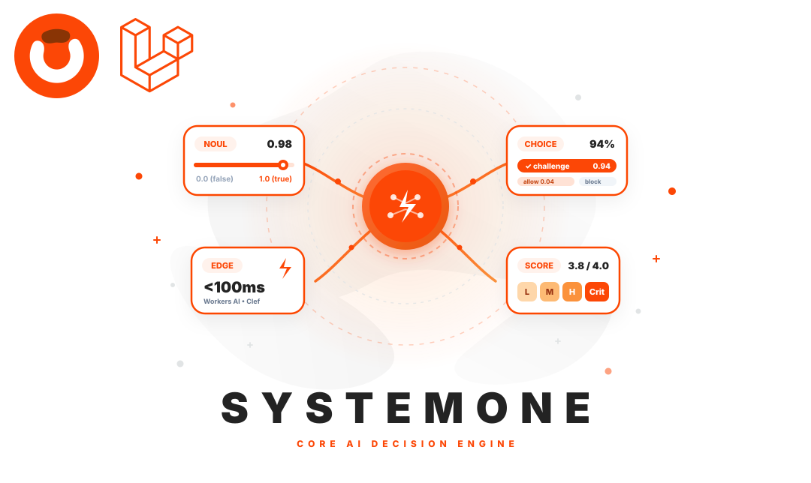

  
  
  

# Obelaw SystemOne

A fast, deterministic AI Decision Engine for modern Laravel applications. SystemOne replaces open-ended conversational prompts with typed decision primitives evaluated at the edge against application states.

## Features

- **Typed Decision Primitives**: Evaluate business states with formal mathematical primitives—`Noul` (binary Bernoulli likelihoods), `Choice` (categorical classification with rubrics), and `Score` (bounded numerical ratings & ordered rubrics).
- **Calibrated Probabilities**: Access true probability distributions, confidence scores, and strict value types instead of unstructured conversational completions.
- **Atomic Multi-Question Queries**: Query multiple decision primitives against the same state payload concurrently in a single network round-trip.
- **Sub-100ms Edge Inference**: Ultra-low latency decision execution powered by edge drivers such as Cloudflare Workers AI (`obelaw/systemone-clef`).
- **Zero Hallucination Surface**: Strictly typed outputs and bounded rubrics eliminate schema drift, markdown fencing issues, and JSON parsing errors.
- **Driver-Agnostic Architecture**: Pluggable driver interface allowing custom adapters for edge models, local LLMs, or private inference endpoints.
- **100% Deterministic Testing**: Fully mockable offline in Pest and PHPUnit with zero token costs and zero network latency.

## Documentation

You can find the detailed documentation here in [Documentation](https://obelaw.com/systemone/).

## Contributing

Thank you for considering contributing to this package! Be one of the Obelaw team.

## License

This package is an open-sourced software licensed under the [MIT license](https://opensource.org/licenses/MIT).
